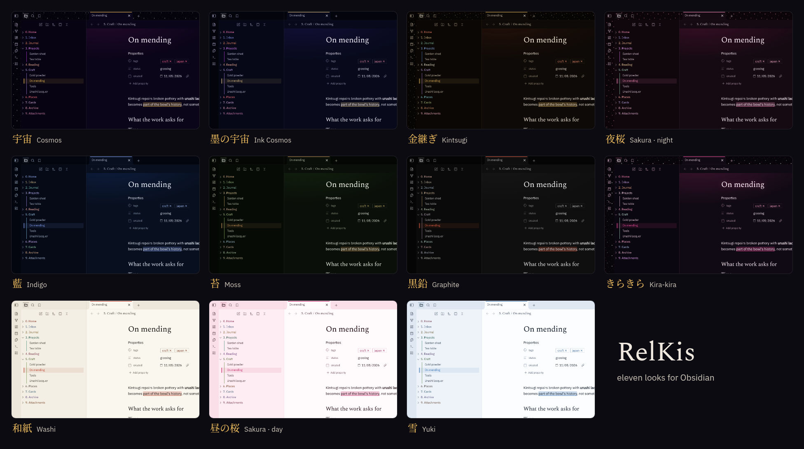
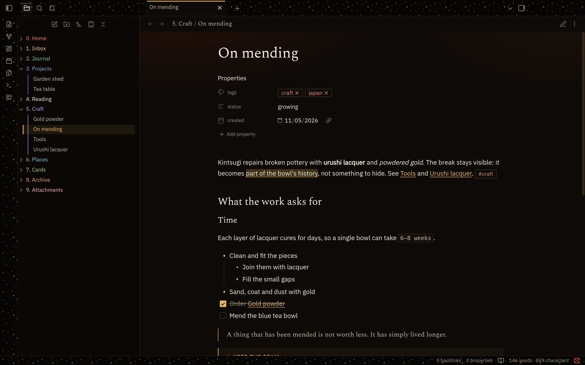

# RelKis

A dark, quiet theme for Obsidian: deep violet, gold accents and Spectral headings. In light mode it turns into
Washi: rice paper, ink and cinnabar.

## What it covers

- **Notes.** Spectral headings, IBM Plex Sans text, gold links, a quote with a thin gold line, callouts, code,
  tables, tags and properties. Two extra callouts: `> [!relkis]` and `> [!kintsugi]`.
- **Window.** A gold line on the active tab, the ribbon, the file explorer, a status bar of its own, menus, settings,
  the command palette, notices and the empty state.
- **Vault sections.** Top-level folders named `0. …` to `9. …` each get a colour, with a thin line along an open
  folder.
- **Plugins.** Kanban, Tasks, Calendar, Buttons, QuickAdd, Omnisearch, Iconize, Editing Toolbar and Highlightr.
- **Phone.** The bottom bar and the editing toolbar follow the theme; touch targets are at least 40 px.
- **Accessibility.** Body text contrast is at least 15.7:1 and captions at least 4.5:1. With “reduce motion” turned on
  in the system, nothing animates.
- **Offline.** The fonts are embedded, so the theme loads nothing from the network.

## Install

Settings → Appearance → Themes → **Manage** → search for “RelKis” → **Install and use**.

Until the theme appears in the catalog, download `manifest.json` and `theme.css` from the
[latest release](https://github.com/kissabmi/relkis-obsidian-theme/releases/latest) into
`<your vault>/.obsidian/themes/RelKis/`, then pick RelKis in Settings → Appearance → Themes.

New versions are published as GitHub releases, and Obsidian offers them as theme updates.

## Looks

RelKis has eleven looks: eight dark and three light. To change them, install the
[Style Settings](https://github.com/mgmeyers/obsidian-style-settings) plugin and open its RelKis section: pick one look
for dark mode and one for light mode. Without it, dark mode is Cosmos and light mode is Washi.

| Look | Mode | What it is |
| --- | --- | --- |
| Cosmos | dark | deep violet and gold, with a quiet haze over the note (default) |
| Ink Cosmos | dark | a colder night, blue ink and pale gold |
| Kintsugi | dark | black lacquer with gold seams and a drop of cinnabar |
| Sakura · night | dark | plum night, pink sakura and lantern gold |
| Indigo | dark | indigo-dyed cloth and silver |
| Moss | dark | a moss garden at dusk and old bronze |
| Graphite | dark | pure sumi ink and one cinnabar accent |
| Kira-kira | dark | black gloss, bright pink, glitter on the frame and a rhinestone bow |
| Washi | light | rice paper, ink and a cinnabar seal (default) |
| Sakura · day | light | pale pink paper, ink and a sakura seal |
| Yuki | light | fresh snow and grey-blue ink |

Each look has its own colours, and you can adjust them in Style Settings too. A companion plugin (not public yet) keeps
its look and the theme's in sync. The theme is complete without it.

## Fonts

Spectral (© The Spectral Project Authors) and IBM Plex Sans (© IBM Corp.) are licensed under the SIL Open Font
License 1.1. They are subset to Latin and Cyrillic and embedded in `theme.css`. IBM Plex Sans is renamed “Nebula Sans”
there because “Plex” is a Reserved Font Name. The license texts are in [`fonts/`](fonts).

## License

The theme is MIT licensed (see [LICENSE](LICENSE)). The embedded fonts are under the SIL Open Font License 1.1.

---

## По-русски

Тёмная спокойная тема для Obsidian: глубокий фиолетовый, золото и заголовки Spectral. В светлой схеме она становится
Washi — рисовая бумага, тушь и киноварь.

**Установка.** Настройки → Внешний вид → Темы → открыть каталог тем → найти «RelKis» → установить и включить. Пока
темы нет в каталоге, скачайте `manifest.json` и `theme.css` из
[последнего релиза](https://github.com/kissabmi/relkis-obsidian-theme/releases/latest) в папку
`.obsidian/themes/RelKis/` своего хранилища и выберите RelKis в Настройки → Внешний вид → Темы.

**Облики.** В теме одиннадцать обликов: восемь тёмных и три светлых. Чтобы их менять, поставьте плагин
[Style Settings](https://github.com/mgmeyers/obsidian-style-settings) и в разделе RelKis выберите облик для тёмной и для
светлой схемы. Там же настраиваются цвета каждого облика. Без плагина в тёмной схеме будет Космос, в светлой — Washi.

**Обновления.** Каждая новая версия выходит релизом на GitHub, и Obsidian предлагает её как обновление темы.

Тема оформляет заметки, окно, разделы хранилища (папки `0. …`–`9. …`), популярные плагины и телефон. Шрифты встроены,
из сети тема ничего не грузит. Лицензия темы — MIT, шрифтов — SIL OFL 1.1.
