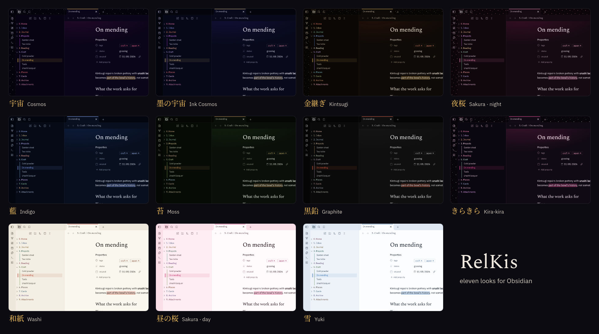
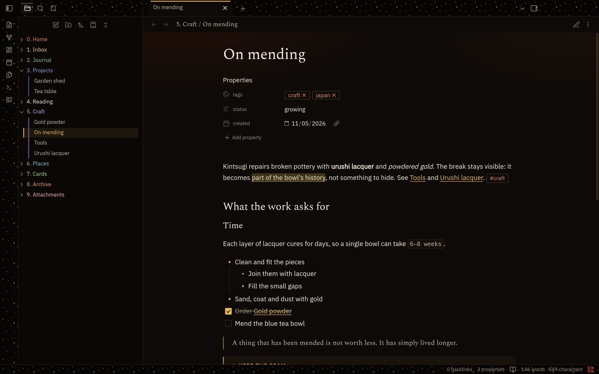

# RelKis

[English](README.md) · **Русский**

Спокойная тема для Obsidian из японских материалов: одиннадцать обликов, от фиолетового с золотом ночью до рисовой
бумаги и туши днём.

## Что оформлено

- **Заметки.** Заголовки Spectral, текст IBM Plex Sans, ссылки и цитаты в цвете акцента облика, выноски, код,
  таблицы, теги и свойства. Дополнительные выноски: `> [!relkis]`, `> [!kintsugi]` и `> [!kira]`.
- **Окно.** Линия акцента на активной вкладке, лента, проводник, своя строка состояния, меню, настройки,
  палитра команд, уведомления и пустая вкладка.
- **Разделы хранилища.** Папки верхнего уровня `0. …`–`9. …` получают свой цвет, а вдоль открытой папки идёт тонкая
  линия.
- **Плагины.** Kanban, Tasks, Calendar, Buttons, QuickAdd, Omnisearch, Iconize, Editing Toolbar и Highlightr.
- **Телефон.** Нижняя панель и панель редактирования следуют за темой, цели нажатия не меньше 40 px.
- **Доступность.** Контраст основного текста не ниже 15,7:1, подписей не ниже 4,5:1. Если в системе включено
  «уменьшение движения», ничего не анимируется.
- **Без сети.** Шрифты встроены, тема ничего не загружает из интернета.

## Установка

Настройки → Внешний вид → Темы → открыть каталог тем → найти «RelKis» → установить и включить.

Вручную: скачайте `manifest.json` и `theme.css` из
[последнего релиза](https://github.com/kissabmi/relkis-obsidian-theme/releases/latest) в папку
`<ваше хранилище>/.obsidian/themes/RelKis/` и выберите RelKis в разделе Настройки → Внешний вид → Темы.

Новые версии выходят релизами на GitHub, и Obsidian предлагает их как обновления темы.

## Облики

В RelKis одиннадцать обликов: восемь тёмных и три светлых. Чтобы их менять, поставьте плагин
[Style Settings](https://github.com/mgmeyers/obsidian-style-settings) и откройте раздел RelKis: там выбирается облик для
тёмной и для светлой схемы. Без плагина в тёмной схеме будет Космос, в светлой — Washi.

| Облик | По-японски | Схема | Что это |
| --- | --- | --- | --- |
| Космос | 宇宙, утю, «вселенная» | тёмная | глубокий фиолет и золото, тихая дымка над заметкой, звёздная пыль по рамке (по умолчанию) |
| Космос · Чернильный | 墨の宇宙, суми-но утю, «космос тушью» | тёмная | ночь холоднее, синие чернила и бледное золото |
| Кинцуги | 金継ぎ, «починка золотом» | тёмная | чёрный лак с золотыми швами, каплей киновари и золотой пылью по рамке |
| Сакура · ночь | 夜桜, ёдзакура, «сакура ночью» | тёмная | сливовая ночь, розовая сакура, лепестки по рамке и золото фонарей |
| Индиго | 藍, ай, «индиго» | тёмная | ткань, окрашенная индиго, и серебро |
| Мох | 苔, кокэ, «мох» | тёмная | сад мха в сумерках и старая бронза |
| Графит | 黒鉛, кокуэн, «графит» | тёмная | чистая тушь суми и один киноварный акцент |
| Кира-кира | きらきら, «блестит, сверкает» | тёмная | чёрный глянец, ярко-розовый, блёстки по рамке и бантик в стразах |
| Washi | 和紙, «японская бумага» | светлая | рисовая бумага, тушь и киноварная печать (по умолчанию) |
| Сакура · день | 昼の桜, хиру-но сакура, «дневная сакура» | светлая | розовая рамка, белый лист, тушь и печать-сакура |
| Юки | 雪, «снег» | светлая | свежий снег, холодная синяя рамка и чистый синий акцент |

У каждого облика свои цвета, их тоже можно настроить в Style Settings.

## Шрифты

Spectral (© The Spectral Project Authors) и IBM Plex Sans (© IBM Corp.) распространяются по лицензии SIL Open Font
License 1.1. Они урезаны до латиницы и кириллицы и встроены в `theme.css`. IBM Plex Sans там называется «Nebula Sans»,
потому что «Plex» — зарезервированное имя шрифта. Тексты лицензий лежат в [`fonts/`](fonts).

## Лицензия

Тема распространяется по лицензии MIT (см. [LICENSE](LICENSE)). Встроенные шрифты — по SIL Open Font License 1.1.
